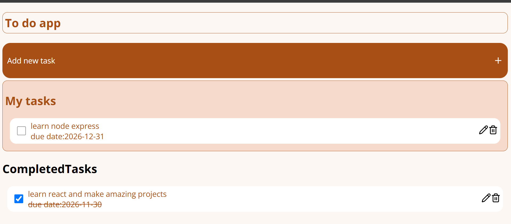

# Todo App

A simple and interactive Todo App built using HTML, CSS, and Vanilla JavaScript. This application allows users to manage their daily tasks by adding, editing, deleting, and marking tasks as completed.

## Features

- **Add Tasks:** Create new tasks with a title and due date.
- **Edit Tasks:** Update existing task details.
- **Delete Tasks:** Remove tasks that are no longer needed.
- **Mark as Completed:** Mark tasks as completed or uncompleted.
- **Task Organization:** Separate completed and pending tasks.
- **Data Persistence:** Save tasks in browser localStorage so they remain available after refreshing the page.

## Technologies Used

- HTML5
- CSS3
- JavaScript (Vanilla JS)
- Browser localStorage
- Lucide Icons

## Getting Started

1. Clone the repository:

   ```bash
   git clone https://github.com/UrbaZahid/javascript-todo-app
   ```

2. Open the project folder.

3. Open `index.html` in your browser.

## Project Structure

```text
Todo-App/
├── index.html
├── index.css
├── script.js
└── README.md
```

## What I Learned

Through this project, I practised:

- DOM manipulation and event handling.
- JavaScript objects and arrays.
- Array methods and CRUD operations.
- Working with JSON.
- Browser localStorage.
- Managing application data and updating the UI.

## Future Improvements

- Add task search and filtering.
- Add task priority levels.
- Improve responsive design.

---



**Built with HTML, CSS, and Vanilla JavaScript.**